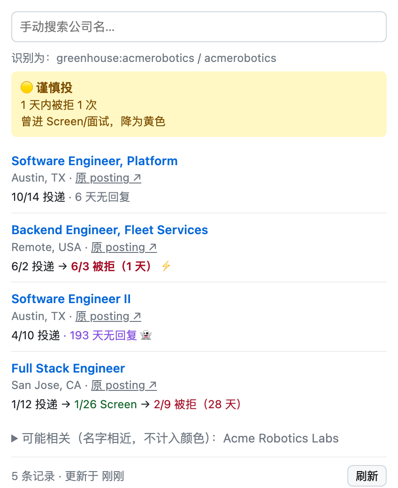

<p align="center">
  
</p>

<h1 align="center">Applied Checker</h1>

<p align="center">
  <b>Did I already apply here?</b> One click on any job posting shows your full
  <a href="https://simplify.jobs">Simplify</a> application history with that company:
  every role, every status change, and a warning color if the company has been rejecting or ghosting you.
</p>

<p align="center">
  
  <br><sub>Demo with fictional data.</sub>
</p>

---

## Why

Simplify's tracker recognizes a job you applied to only when it is the *exact same posting*. Companies repost the same role every few weeks under a new ID, so the "already applied" badge often doesn't show up, and Simplify's own search needs the company name typed exactly as it was stored (`NorthwindBank` and `Northwind Bank` are different companies to it).

Applied Checker looks the company up by name across all of your tracked applications. It doesn't care which posting you applied through, and it shows the whole history so you can decide whether reapplying is worth your time.

## Features

- **One click, no typing.** Open a posting, click the icon (or press <kbd>Alt</kbd>+<kbd>S</kbd>). The company is detected from the page.
- **Full history per company.** Every application with its title, location, and a status timeline such as `1/12 Applied → 1/26 Screen → 2/9 Rejected (28 days)`.
- **Jump straight to the record.** Each job title links to that application in your Simplify tracker so you can compare the job descriptions. A second link opens the original posting.
- **Warning colors** based on how the company has treated your past applications. See [Color rules](#color-rules).
- **Matching that tolerates messy names.** ATS company slugs, normalized names (`GLOBEX INC` = `globex`), and the same company ID across records. Near-misses are listed separately under "possibly related" so they can't produce a false warning.
- **Manual search** as a fallback, with partial-name matching.
- **Fast and always current.** Results render instantly from a local cache while the latest data is fetched in the background on every open.

## Color rules

An application **went nowhere** if it was rejected, or if it is still in *Applied* more than **30 days** after you applied (ghosted 👻). Most rejections arrive within three weeks, so a month of silence is a reliable signal.

| Color | Meaning | Triggered by (any one) |
|---|---|---|
| 🔴 | Probably not worth applying | Rejected within **1 day** at least once · Rejected within **3 days** 2+ times · **5+** applications went nowhere and none reached a screen |
| 🟡 | Apply with caution | Rejected within **3 days** once · **3–4** applications went nowhere and none reached a screen |
| 🟢 | No red flags | Nothing above, including companies you have never applied to |
| ⚪ | Unsure | No exact match, but similar company names exist. Check the "possibly related" list |

**Exception:** if any application at that company ever reached a screen or interview, the color is capped at 🟡. The company does look at your applications; those specific roles just didn't work out.

The popup always states which rule fired (for example "3 天内被拒 2 次", rejected within 3 days twice), and the flagged applications are marked in their timelines (⚡ for fast rejections, 👻 for ghosting). The color is a hint; the decision stays with you.

> Rejection time is when the application was marked *Rejected* in Simplify, so keep your tracker up to date for accurate colors.

## Supported sites

| Kind | Sites | How the company is identified |
|---|---|---|
| Applicant tracking systems | Greenhouse (including embedded boards), Ashby, Lever, SmartRecruiters, Workday, iCIMS, Workable, Breezy HR, JazzHR, Recruitee | Company slug in the URL, e.g. `job-boards.greenhouse.io/acme`. Matches even when the company's display name differs |
| Job boards | LinkedIn (job pages and the search split view), Indeed, Handshake | The company shown next to the open posting. If you applied to that exact posting, its posting ID also matches directly |
| Any site with structured job data | Company career sites, HigherEdJobs, and most pages indexed by Google Jobs | The employer in the page's `JobPosting` structured data |
| Company career sites without it | e.g. `careers.acme.com` | Domain name |
| Anything else | | Type the company name into the search box |

Tested on real pages: Greenhouse, Ashby, Lever, Workday, LinkedIn (job page and search view), Indeed (job page), HigherEdJobs. Handshake and Indeed's search view use the same rules but have not been verified yet. If a site isn't detected, please [open an issue](../../issues) with the URL.

## Install

Applied Checker isn't on the Chrome Web Store yet. Load it unpacked:

1. Download this repository (**Code → Download ZIP** and unzip, or `git clone`).
2. Open `chrome://extensions` and turn on **Developer mode** (top right).
3. Click **Load unpacked** and select the project folder.
4. Pin Applied Checker from the puzzle-piece menu in the toolbar.
5. Make sure you are signed in to [simplify.jobs](https://simplify.jobs) in the same Chrome profile.

To update, pull the latest code and click ↻ on the extension card in `chrome://extensions`.

## Usage

1. Open a job posting on any site.
2. Click the Applied Checker icon or press <kbd>Alt</kbd>+<kbd>S</kbd>.
3. Read the color, scan the history, and click a job title to open that record in Simplify.

The toolbar icon keeps the color and the application count for that tab after the popup closes. If no company is detected, type part of its name into the search box.

## Privacy

- **No servers, no accounts.** The extension talks only to `simplify.jobs`, using the Simplify session already in your browser. Nothing is sent anywhere else.
- **Nothing is stored in this repository or in the extension's code.** Your Simplify login is read from the browser at the moment of each request and never saved.
- **Local cache only.** A trimmed copy of your tracker (company, title, links, status timeline; no job descriptions) is kept in `chrome.storage.local` so the popup opens instantly.
- **Permissions:** `activeTab` and `scripting` read the company from the posting you're viewing, only when you click. `cookies` reads Simplify's CSRF token. `storage` holds the cache.

## Limitations

- Uses an **undocumented Simplify API** (`/v2/candidate/me/tracker/`). If Simplify changes it, the extension may break until it's updated.
- Very different spellings of the same employer (`CU Boulder` vs `University of Colorado Boulder`) won't match. A subsidiary that hires through its parent's career site is grouped with the parent.
- The popup UI is currently in Chinese.

## How it works

```
manifest.json   MV3 manifest
popup.html/css  Popup UI
popup.js        Detects the company on the page, fetches and caches the tracker, renders results
lib.js          Pure logic with no Chrome APIs: URL/ATS parsing, name normalization, matching, color rules
```

On each open, `popup.js` injects a small function into the active tab. It reads the page's `JobPosting` data, known job-board elements, and iframes, then combines that with ATS slugs parsed from the URL. It then loads every tracker page from Simplify in parallel (500 records per request), trims each record, and passes the records to `findMatches` and `classify` in `lib.js`.

## Disclaimer

Not affiliated with or endorsed by Simplify. This is a personal tool built on top of the Simplify tracker you already use.

## License

[MIT](LICENSE)
